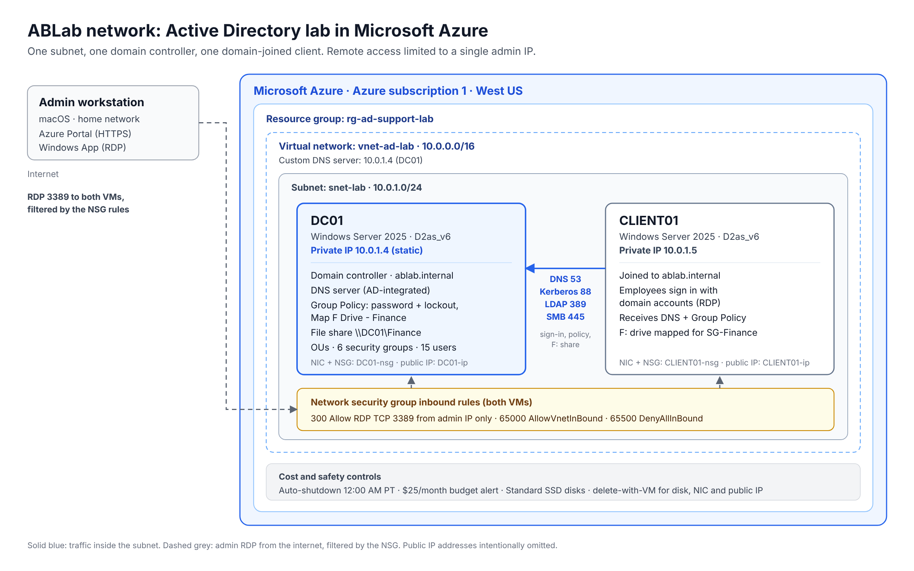

# Active Directory Employee Onboarding & Help Desk Lab

A working Windows Active Directory environment built in **Microsoft Azure**, used to onboard 15 employees and resolve 6 realistic help desk tickets — from password resets to a Group Policy root-cause troubleshoot.



## At a glance

| | |
|---|---|
| Platform | Microsoft Azure, managed from macOS (Azure Portal + Windows App) |
| Domain | `ablab.internal` (NetBIOS `ABLAB`) |
| Servers | **DC01** – domain controller + DNS (10.0.1.4) · **CLIENT01** – domain-joined client (10.0.1.5) · Windows Server 2025 |
| Directory | `ABLab` OU → 5 department OUs, 6 security groups, 15 users |
| Automation | PowerShell bulk onboarding from CSV · Azure Run Command |
| Security | RDP limited to one admin IP · least-privilege file share · 12-char password policy + lockout |
| Cost control | Nightly auto-shutdown · $25/month budget alert |

## What I built

1. **Azure foundation** – resource group, virtual network `10.0.0.0/16`, subnet `10.0.1.0/24`, network security groups allowing RDP only from my IP.
2. **Domain controller** – promoted DC01 to a new forest `ablab.internal` with AD-integrated DNS; pointed the VNet's DNS at DC01.
3. **Client** – deployed CLIENT01 and joined it to the domain.
4. **Onboarding** – OU structure, department security groups, and 15 users created from a CSV with [`Onboard-NewHires.ps1`](scripts/Onboard-NewHires.ps1).
5. **Help desk** – six tickets worked end to end and logged in [`ABLab_Ticket_Log.xlsx`](docs/ABLab_Ticket_Log.xlsx).

## Help desk tickets

| # | Request | Resolution | Evidence |
|---|---|---|---|
| 1001 | Forgotten password | Identity verified, reset, change forced at next logon | [screenshot](screenshots/05-t1001-password-reset.png) |
| 1002 | HR → Marketing transfer | Moved OU, updated title/department, added SG-Marketing, removed SG-HR | [screenshot](screenshots/06-t1002-transfer-groups.png) |
| 1003 | Employee offboarding | Disabled (not deleted), groups removed, moved to Disabled Users | [screenshot](screenshots/07-t1003-disabled-user.png) |
| 1004 | Weak password policy (audit) | 12-char min, complexity, 24 history, 90/1-day age, lockout after 5 tries | [screenshot](screenshots/08-t1004-password-policy.png) |
| 1005 | Locked-out user | Reproduced lockout, unlocked via ADUC + `Unlock-ADAccount` | [screenshot](screenshots/09-t1005-lockout-error.png) |
| 1006 | Finance shared drive | `\\DC01\Finance` restricted to SG-Finance, mapped as F: by Group Policy | [screenshot](screenshots/14-t1006-finance-drive.png) |

### Troubleshooting highlight – the drive that didn't map
`gpresult` showed the drive-map GPO as applied, yet no F: drive appeared and nothing was logged.

1. `Test-Path \\DC01\Finance` → `True` – share and permissions were fine.
2. `whoami` → the user's own session, not an elevated admin window.
3. Read the GPO's `Drives.xml` in SYSVOL → item-level targeting had **Primary group** ticked, so it only matched users whose *primary* group was SG-Finance.
4. Switched to **User in group**, `gpupdate /force`, sign-out/in → **F: mapped**.

See [gpresult](screenshots/13-t1006-gpresult.png) · [the fix](screenshots/12-t1006-targeting-fix.png) · [result](screenshots/14-t1006-finance-drive.png).

## Bulk onboarding script

```powershell
.\Onboard-NewHires.ps1 -CsvPath .\new_hires.csv
```

For each CSV row it builds a `firstname.lastname` account in the department OU, sets title and department, assigns a temporary password (prompted, never stored), forces a change at first logon, and adds the user to `SG-<Department>`. Existing users are skipped and a log is written. If a password is rejected by policy, the partially created account is rolled back.

## Lessons learned
- **Check the defaults** – Windows auto-filled an 88-day *minimum* password age; corrected to 1 day so users can change a compromised password.
- **A failed command can still change things** – a rejected password left disabled accounts behind; the script now rolls back.
- **"Applied" isn't "worked"** – one targeting checkbox silently blocked a GPO.
- **Least privilege by default** – removed inherited Authenticated Users access from the Finance share.

## Repository contents
```
scripts/      Onboard-NewHires.ps1, new_hires.csv (fictional employees)
docs/         Network diagram (PNG + SVG), help desk ticket log
screenshots/  Evidence for each phase and ticket (public IPs removed)
```

## Skills
Active Directory DS · DNS · Group Policy (security policy, Preferences, item-level targeting) · NTFS & share permissions · PowerShell · Azure VMs, VNets & NSGs · Help desk process & documentation

---
*All names are fictional. Public IP addresses and account identifiers have been redacted.*
